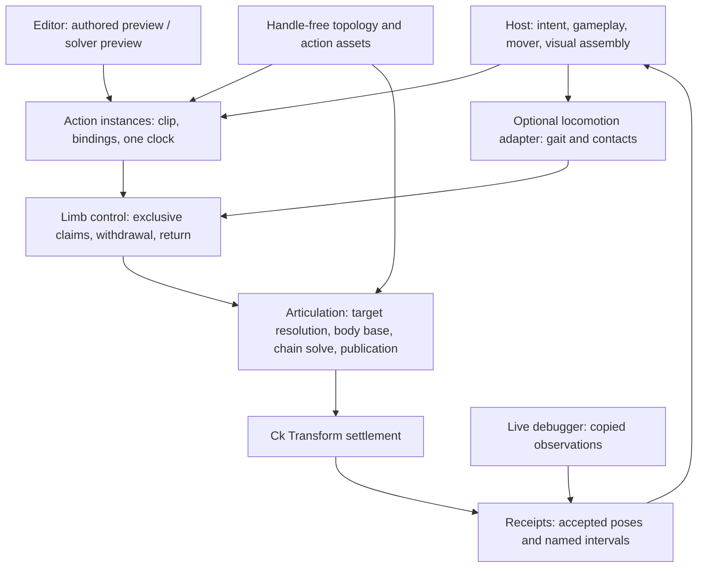

# Runtime architecture

Proposed contracts, 2026-10-11. Evidence IDs resolve in [RESEARCH.md](RESEARCH.md). Acceptance IDs resolve in [VALIDATION.md](VALIDATION.md).

## 1. Layering and dependency direction



These are feature boundaries within CkProceduralAnimation, not five new runtime modules. Rigid kinematic action intent is intrinsic to procedural animation. Generic easing stays in CkTween; asset loading in CkResourceLoader; root movement in the host mover; rendering in existing render features. Add only those runtime dependencies actually consumed (Tween and ResourceLoader); do not create a reverse dependency.

Articulation owns 0–64 limbs; a body-only subject has zero. A gait captures 2–64 locomotor members. Each limb has 1–8 rigid segments. These bounds retain existing bitmask/solver constraints rather than implying unlimited topology. Topology is sealed at successful composition; detach preserves stable identity, destruction leaves a tombstone slot. Adding/removing topology requires explicit subject reconstruction.

## 2. Ownership

| Resource | Sole authority |
|---|---|
| Simulation root world transform | SurfaceMotion or consumer-selected external mover |
| Limb geometry, attachment, stable index, live part binding | Articulation |
| Walking foot plan, grounded contact, reservation | Gait adapter |
| Which producer may supply a limb target | LimbControl state machine |
| Authored action clock and phase/window intent | One ActionPlayer instance |
| Environmental body base | BodyPose; identity base for subjects without support |
| Body action offset | One claimed body channel; legacy caller owns it on legacy subjects |
| Segment/terminal/presentation transform requests | Articulation publisher |
| Confirmed settled action output | Receipt publisher after transform settle |
| Damage or other gameplay result | Consumer |

No direct mesh transform API is added. Limbs and bound parts remain direct lifetime children of the subject root, matching current admission. A SceneNode whose parent writes its world transform cannot be a bound part; neither can a part already owned by another pose/physics writer. Scale is visual-only; kinematic transforms remain unit-scale. Binding validation diagnoses the conflicting owner and part.

A generic limb and an existing procedural leg are features on the SAME entity, not two mirrored entities. Legacy Leg utilities retain their signatures and forward compatible operations. Generic geometry has one storage home; legacy getters project that data. Dedicated limbs never acquire a fake gait slot.

## 3. Limb state is not one enum

The authority-owned state is split by meaning:
- Structural state: attached, detached, destroyed. Detached is irreversible for the entity identity.
- Administrative state: enabled/disabled. Disable remains a request to freeze/exclude, not a request for action control.
- Locomotion membership: immutable optional gait index.
- Controller state: Default, Acquiring, Authored, Returning, Unplanted.
- Contact evidence: trusted plant, untrusted/guessed, airborne; plus sequence and normal.
- Action claim: owning action entity and monotonically increasing generation.

Default means Gait for a locomotor member and Rest for a dedicated appendage. A foot in Authored or Returning state is never a support contact merely because its endpoint touches the ground. A successful gait touchdown supplies that evidence.

## 4. Claim transaction and concurrency

An action declares its entire resource set from compiled bindings: limb IDs plus optional body channel. Admission checks live scope/subject, content revision, required parts, administrative state, runtime binding compatibility, conflicting claims, supported return policy, and aggregate support requirements. A locomotor limb in Unplanted, Returning or Acquiring is unavailable; recovery cannot be bypassed by starting another action. A body channel requires a valid bound presentation transform, including on a zero-limb subject. One failing requirement rejects the complete action without taking any claim.

Disjoint actions may coexist. Support is checked against the UNION of all currently withdrawn limbs and the candidate set. Concurrent admissions are serial per subject in enqueue order with a monotonically increasing subject sequence, never hash-map iteration order. No automatic preemption, priority guessing, partial claim or queue. A conflict returns Busy with the conflicting action and resource IDs.

Body action control is subject-exclusive relative to other actions through acquisition, playback and return: its changing attachments couple every limb solve. A combined body-plus-limb move belongs in ONE action. Limb-only actions may coexist on disjoint resources, subject to joint clearance validation. This explicit release-1 rule avoids pretending disjoint handles imply geometrically independent poses. Environmental BodyPose and gait still run; their constraints may reject an action pose.

The internal publication bridge evaluates one complete subject batch, including held/returning claims, after the environmental body and gait inputs are ready. Pure evaluation returns an opaque input revision, copied predicted observations, and private exact solved poses. Staging adopts those exact poses only if the revision is still current; all candidate channels pass or the entire batch is rejected. The sole publisher must not recompute a different candidate after sampling qualified it. Per-token stage keys map to the shared subject revision and become evidence only after actual transform settlement. Adaptive sampling uses a common service fraction across the participating actions; reducing one action's admissible prefix recomputes the joint batch. This also prevents disjoint limb clearance from invalidating an earlier independent sample. Body subject-exclusivity remains unchanged.

Claims are non-owning references to scope-owned action entities. The action entry acquires, action exit initiates release/return exactly once. Articulation reconciles every tick against action existence, subject/scope lifetime and generation. A missing owner initiates return without waiting for a signal. Dedicated rest and returned gait control do not depend on a living action entity.

A body-only external action caller and an ActionPlayer cannot write the same body channel. Existing Request_SetActionOffset remains available only while that channel is unclaimed; managed calls use internal token-validated submission. Rejected legacy writes report ownership conflict. Opt-in migration prevents existing callers from silently competing.

## 5. Locomotion handoff

States:
```text
Default(Gait) -> Acquiring -> Authored -> Returning -> Default(Gait)
                           \ cancel ----^             (trusted touchdown)
any live state -- part lost/detach --> structural invalid, revoke
Returning -- deadline/probe exhaustion --> Unplanted (no claim, no support)
Unplanted -- explicit recovery request --> Returning
Default(Rest) -> Authored -> Returning -> Default(Rest)
```

Acquiring a walking limb:
1. Reserve resources, but keep its CURRENT gait contact until withdrawal commits.
2. Evaluate the remaining trusted stance in the accepted support frame. Require a configured support policy (see below).
3. Capture actual accepted chain/endpoint as the entry pose. Clear that limb's pending step, swing, plant trust and reservation together at the handoff boundary.
4. Publish controller/participation change with a new generation; first authored sample is continuous with the captured pose.
5. Advance clip time only after all required limbs and the optional body channel acknowledge acquisition.

A support requirement specifies MinimumTrustedContacts and either CountOnly or ProjectedSupportRegion with an inset in cm. Borrowing requires an explicitly authored valid requirement; no hidden universal three-leg rule. ProjectedSupportRegion uses trusted contact points in a coherent support plane and the projected root as a declared support proxy. It is a kinematic admission test, NOT a claim of physical balance or COM stability. Degenerate hulls reject that mode; bipeds may explicitly choose CountOnly. A multi-surface stance without a coherent frame rejects borrowing in release 1.

Waiting for support is bounded by AcquisitionTimeout. Acquisition requests do not force arbitrary foot motion to manufacture support. A later iteration may offer an explicit stance-preparation action through the same controllers.

While limbs are borrowed or returning, the gait solver must preserve the aggregate support requirement BEFORE any planned takeoff, including catch-step, emergency and beyond-schedule lanes. Evaluate the prospective stance after each candidate swing in deterministic gait order; suppress a takeoff that would break the requirement. A biped explicitly borrowing one foot with CountOnly/MinimumTrustedContacts=1 therefore keeps its remaining trusted foot planted. CountOnly does not promise a physically stable stance.

Blocked locomotion is bounded by SupportHoldTimeout. An emergency that cannot preserve support, or expiration of that timeout, emits SupportEmergencyRequested and DEFERs that takeoff for this solve. The subsequent action/control stage cancels the affected actions and publishes closure; next service may remove their protection and admit the emergency step. Normal return retains protection; emergency cancellation explicitly permits degraded support during bounded recovery. Unexpected contact loss cancels at the next service. There is no claim of preventing an externally removed floor. The host mover may need to pause when support is constrained; SurfaceMotion retains root authority and reads the reduced participating stance. An external mover that forces the root beyond reach causes diagnosed cancellation, not a hidden root correction.

BodyPose separates structural loss (legacy sag due to disabled/detached legs) from intentional withdrawal (no damage-like collapse). Conform fitting and root reach pacing use actual participating contacts; free/action endpoints must not accidentally pin root motion or body reach. Geometry alone cannot restore trusted contact.

Returning a walking limb:
1. Close all action windows and revoke the action's right to submit new motion.
2. Recovery remains owned by the articulation, beginning at its last settled endpoint and orientation. At entry it captures return policy/tuning revision, source pose, remaining retries, destination/reservation and an absolute deadline in service time. Cancelling again, releasing an action or destroying its scope cannot reset that deadline or discard that payload.
3. Use the existing foothold queries, reach checks and reservations to choose a valid landing.
4. Blend through a bounded return path; publish it through the same solver/publisher.
5. Commit gait ownership only after verified touchdown; initialize solver from that accepted contact, phase and trust. Do not restore the stale pre-attack plant.
6. If return fails, publish RecoveryFailed, release claims, and retain an explicitly Unplanted limb excluded from support. Get_RecoveryState remains observable; explicit Request_Recover can retry after the world changes.

An invalid/detached part is never moved, re-enabled or reacquired. When the whole subject dies, end immediately without trying to pose its parts.

## 6. Scheduling and sample transaction

Preserve scheduler groups; do not modify CkEcs global scheduling for this feature. Proposed ordering must pass Gate 0 before depending on it:

| Stage | Group and responsibilities |
|---|---|
| Intent | Gameplay consumers enqueue play/cancel/update requests |
| Reconcile | Physics, explicitly before SurfaceMotion_Update: process claim liveness and cancellation; invalidate stale participation generations |
| Root | Existing SurfaceMotion physics pass reads only prior stance entries still eligible under current generation |
| Locomotion | Transform_Derived: legacy leg requests, gait setup/preset and gait solve; unchanged no-action path |
| Environmental base | After gait: BodyPose computes its environmental base and legacy Rig computes the default chains; neither publishes bound transforms |
| Action/control | After gait and environmental base: acquire from settled prior pose/current stance, compose body action, resolve limb spaces and evaluate complete subject candidates including clearance |
| Articulation | After control: adopt the selected exact candidate or the legacy default and issue all bound transform requests through the sole publisher |
| Settlement | Existing Derived local transform settle |
| Receipt | Gameplay_Camera, the documented reader slot after all Transform_Finalize resolution: confirm actual part transforms equal staged sample, then publish receipt |
| Consumer | Host resolver in Overlap after its probe transforms update; reject stale/incomplete receipts before game effects |

Any acquisition committed in Derived increments participation generation immediately. Next Physics must revalidate BOTH reach stance and fitted feet-plane evidence, not merely the reach-anchor list. Otherwise a withdrawn foot could continue supporting root height for a frame (E11).

Implementation refinement (Gate 3): recovery admission and preparation run in Derived after Gait/BodyPose so SurfaceMotion support is from the current frame. Return settlement/handoff runs in Gameplay_Camera after Articulation observation, before the next gait solve can invalidate the candidate sequence. Physics remains responsible for monotonic deadlines and owner-loss reconciliation. A mixed return uses the same accepted service fraction for all moving channels, but locomotor interpolation pauses while no qualified landing exists; dedicated/body channels may return against held actual locomotor endpoints. Each policy retains its original absolute deadline. This avoids either jumping to a late landing or forcing an unrelated dedicated channel to wait for a probe.

Editor host refinement (Gate 3): selecting a base GameMode in a Game world does not isolate host world subsystems. The solver uses a marked GamePreview world created before InitWorld. CkEcs and Jolt explicitly opt into this marker; ordinary preview worlds and the general Ck subsystem base do not change. Host script world subsystems remain excluded. Immediate-close teardown still exercises the ordinary ECS cancellation contract.

All required outputs of one action share instance, generation, sample sequence, content revision and interval. Build a SUBJECT-wide candidate pose without mutating final state, including gait and every active action. If any required candidate fails reach/clearance policy, submit none of that candidate. Cancel the failed action with the specific track reason and other contributing actions with SubjectPoseRejected; do not invent a priority winner or publish a successful subset. Recovery re-solves from actual settled poses. Ordinary locomotion may resume in a later coherent batch. Never publish staged transforms from a cancelled generation.

Current CkTransform requests settle individually (E08); this design promises atomic admission and receipt qualification, NOT an atomic render-visible transform transaction. Preflight and one publisher reduce partial updates but cannot roll back a destroyed part or external writer. After settlement, compare every live required transform and ownership revision against the staged pose. On mismatch, publish no accepted sample, advance no action clock and close all action windows with PublicationFailed. Preserve copied ACTUAL settled surviving transforms, mark the articulation Faulted, revoke submission claims and suppress further bound-part writes. The visible partial pose is the observed truth; never substitute the previous complete pose in diagnostics or collision receipts.

Faulted is a separate articulation health state, not Unplanted. Queries remain valid. Recovery is Failed for active actions; recompose the subject after fixing its bindings/foreign writer to resume. No automatic rollback, transform stealing or retry against a possibly external owner. This deliberately fail-stops an ownership-integrity breach. Expected detach processed before staging remains the normal detach/replant path, not a fault. Gate 0 must prove late-settlement detection and that no successful receipt/effect escapes this case; if consumer ordering permits that, the proposed schedule must be revised.

## 7. Action clock and timing

Each action has one clock, driven by FCk_Time. Curves, body offset, limb paths, markers and windows derive from that clock. There is no independent timer per track and no independent damage clock in the framework.

A positive-time tick proposes DeltaTime * PlayRate plus prior backlog. Subdivide the proposed interval so EACH evaluation step is at most Sampling.MaxAdvance; this is not a cap on total per-frame advancement. Refine further to satisfy endpoint/angular bounds, and split at every marker/window edge. Stop at the first phase boundary: that endpoint must be represented in a settled receipt before advancing into the next phase. Multiple evaluated substeps may precede one settled terminal pose, clearly labeled as such. No catch-up may skip an unobserved phase. If MaxSamples limits work, accept only the qualified prefix and retain backlog; if backlog/deadline limits are exceeded, terminate SamplingBudgetExceeded. Never claim nominal wall-clock duration in that case.

Zero/nonpositive simulation time: process lifetime invalidation and cancellation on any serviced pump, but do not advance, emit crossings or fabricate a new accepted revision. Watchdogs use a monotonic SERVICE clock advanced by nonnegative elapsed time between serviced pumps; pause/resume cannot reset deadlines. If no pump runs while the world is paused, no immediate cleanup or deadline response is promised; reconcile before further pose work on the first resumed pump. Registry/world teardown explicitly releases resources without waiting for time or another tick. Preview sessions provide their own serviced pump and close path. Do not use wall-clock time in the pure evaluator or claim paused-world behavior before Gate 0 proves its service path.

An action pins an immutable compiled content revision. Tuning cannot change phase durations mid-phase. Request_UpdateTuning is idle/next-instance by default; a live change returns RequiresRestart. No raw mutable asset arrays in processors.

## 8. Coordinate and retarget contracts

Each track declares one space:
- BodyLocal: cm in the current simulation root frame, before visual scale.
- RootAtStart: cm in the root frame captured when all acquisitions commit, immediately before entry blending; remains fixed in world. Admission wait cannot make this frame stale before playback starts.
- AnchorAtStart: cm in an explicitly caller-supplied immutable frame value copied on creation. It is a deliberate snapshot, not a live target; authoring shows its age during acquisition.
- LimbRestNormalized: endpoint offsets normalized by chain length in the limb's authored rest frame; explicitly opted into.

For LimbRestNormalized, the endpoint is `Offset(rotation, position * chainLength) * RestEndpointLocal * AttachmentLocal * finalPosedBodyWorld` using Unreal transform composition. Zero translation/identity rotation therefore requests the authored rest endpoint. Bend values remain directions: rotate through the selected space frame, then form the world pole at the current posed hip plus that unit direction times chain length. They are never translated as positions. Entry capture performs the inverse mapping, including division by validated positive chain length. BodyLocal continues to mean the simulation root, not the posed visual frame.

Resolve spaces only after environmental body pose is known. Body tracks are simulation-body-axis offsets, preserving existing semantics. Limb IK attachment follows posed body, while endpoint anchoring follows the declared space. Do not apply the body action twice. Keys and tangents are transformed consistently. No automatic mirroring or size normalization; explicit editor Mirror produces inspected new keys and slot mapping. Live tracking/warping is a future input-provider extension, not a hidden reference read during a strike.

Each slot uses one space/anchor throughout a clip; cross-phase frame changes reject at compile. Sparse held channels retain that canonical frame. Capture accepted entry targets by converting to that frame once, rather than treating a world pose as authored local coordinates.

Retarget validation checks slots, available reach, matching endpoint orientation capability and rest frame. Different proportions may project motion; diagnostics report requested/accepted endpoint and projection amount. Callers choose RejectUnreachable or ProjectToReach per clip track; projection is never silent. Pole direction guides a solve; it is not a biomechanical joint-limit promise.

## 9. Trajectories, collision and publication limits

The runtime publishes accepted articulated poses, endpoint error, clearance result and named active intervals. It does NOT declare a hit. Existing rig clearance is candidate selection/diagnosis, not arbitrary continuous collision detection.

A receipt includes previous and current settled segment poses, action time interval, any evaluated intermediate solver samples, and discontinuity flags. Intermediate samples are explicitly 'evaluated', not claimed as rendered frames. Sampling bounds MaxAdvance, MaxEndpointTravel and MaxSegmentAngularStep are tunables; reaching MaxSamples refuses advancement rather than taking a large unchecked step.

These bounds do not prove exact continuous coverage of a nonlinear IK path. An action with a solver branch jump, root teleport or unsupported reference-frame change publishes discontinuity and closes usable windows. The consumer decides whether a bounded approximation is sufficient or uses conservative swept geometry. A melee adapter must validate full segment coverage (not tip-only), world blocking and frame hitches separately. Never generalize the existing body-jab sphere sweep into a limb CCD claim.

Return after an environmental root change can require an explicit IK reattachment even when the claimed endpoint has not moved. A zero-time return candidate is evaluated against the last actual settled chain; if it exceeds the motion budget, the player closes every usable window on the subject and moves all claims to return before publishing one explicit held-endpoint reattachment through Articulation. Held endpoints and claimed body presentation must survive IK and clearance preflight without projection. Only actual settled observation rebases the return pose and gait recovery origin. This publication advances no action or return clock, emits no accepted action receipt, and never restarts the original return timeout or probe-attempt budget. Failed preflight or settlement retains protection until the finite recovery failure path, without declaring a trusted plant.

## 10. Lifetime, assets, results

Assets load through a CkResourceLoader rooted batch with a consumer ID and finite LoadTimeout. Before Ready: validate, compile to immutable value data, bind names, then admit. No resources are claimed while waiting on assets. Cancellation/owner destruction resets the batch; stale completion checks instance generation and cannot resurrect the action.

Default mode compiles self-contained value tracks and may release asset roots after compilation. Optional future external curve providers must retain their full dependency root until no compiled data points at them. A raw TObjectPtr/TStrongObjectPtr in an ECS fragment is not the declared ownership solution.

Each action instance is a lifetime child of caller scope; instances retain terminal result until scope destruction or explicit Release. Player-owned bounded streams reserve closure/terminal record storage at creation and survive action-entity removal while their player lives (API section 6). The finite capacity budget includes active instances and retained result/stream reservations; CapacityExceeded never silently evicts unread state. Consumers should use a state-scoped owner; long-lived callers must Release terminal instances and acknowledge stream records. Releasing a nonterminal instance means cancel-and-release; recovery payload and original deadline are already owned by articulation.

Requests have normal completion delegates (deferred operation admission); OnFinished and Get_Result report playback terminal outcome. Get_State is level-triggered. Pollable result remains even if a signal is missed. EndPlay completes pending delegates once; dead targets cannot receive gameplay signals. Logs identify unobserved terminal failures per resilience doctrine.

Terminal outcomes distinguish Completed, Rejected, Cancelled, OwnerLost, SubjectLost, PartLost, AssetFailed, InvalidContent, SupportLost, AcquisitionTimeout, PublicationTimeout, PublicationFailed, SubjectPoseRejected, SamplingBudgetExceeded, ReceiptOverflow, InputTimeout and RecoveryFailed. Normal playback is Completed only after all resources returned. A cancellation outcome reports its reason and whether recovery succeeded. Terminal/window-close stream records do not require an accepted pose and cannot claim one.

## 11. Compatibility and future boundaries

Legacy Add_Walker creates an articulation facade internally, maintaining names, handles, order, mesh conventions, gait defaults, public signals and existing body-action semantics. Old rig assets remain valid; conversion to a new articulation asset is an explicit editor operation writing a sibling asset with a migration report. No silent asset rewrite.

Legacy visual chain bindings are optional. `ProceduralLeg::Get_Legs` retains the complete simulation topology; articulation exposes only the bound, controllable chains in topology order. An unbound simulation leg has no invented settled geometry and cannot be claimed by an action. Zero bound chains may still publish a separately bound body presentation. The broader Gate 1 run exposed an unconditional Rig Params read that violated this contract; the repair and focused fixture are pending in PROGRESS.

Retain legacy diagnostic getter shapes; add an articulation revision distinct from gait solve sequence. Debugger and samples label which sequence they carry. Borrowed healthy legs remain structurally enabled; add gait-participation queries so consumers do not confuse enabled count with trusted support. Existing game MinLegsToWalk remains a structural damage policy until explicitly migrated.

Standalone limbs must work with no gait, Jolt contact policy or BodyPose environment. Clearance None is explicit, not a fallback after failed world acquisition. With an opted-in world policy, absent world is a failure.

Future seams: skeletal presentation adapter at publication boundary; constrained-joint solver behind chain-solve boundary; physics secondary motion after clearly delegated ownership; live target anchors with explicit update policy; externally synchronized clip time with revision tokens; network/save adapter supplying authoritative commands. None is advertised as implemented by release 1. No claim of physical whip elasticity, cross-platform determinism or rollback safety.

## 12. Extension quality bar

Do not introduce global registries for action dispatch, arbitrary UObjects per keyframe, string-command execution, game-specific tags, or custom graph machinery. Add a new track/control kind only with two concrete consumer examples, a data-placement table, state/ownership contract, adversarial tests and editor representation. The extension boundary is explicit C++ data and processors; do not prematurely expose a scripting plugin system that bypasses admission.

